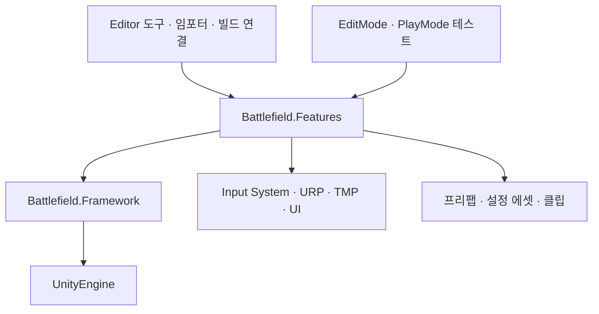
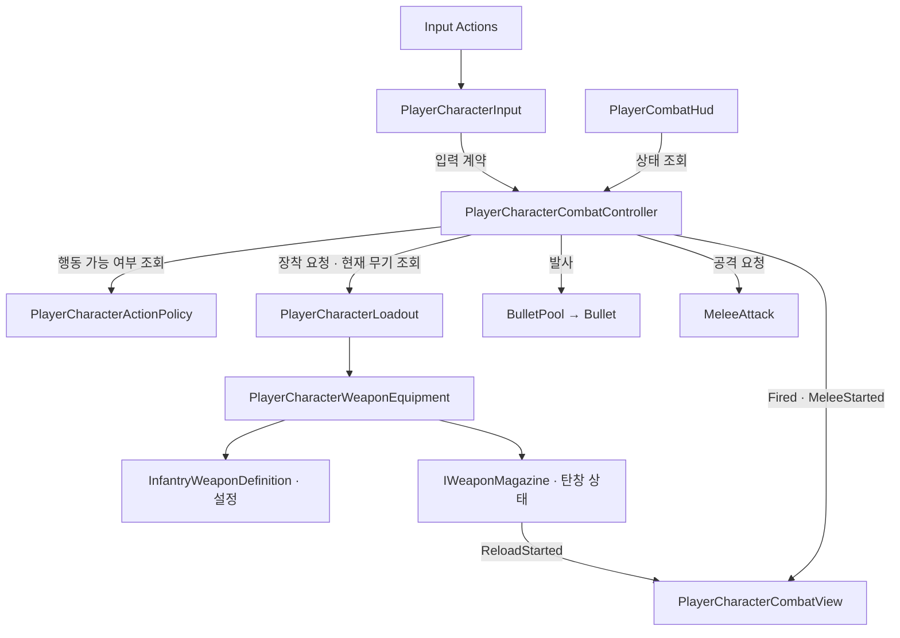
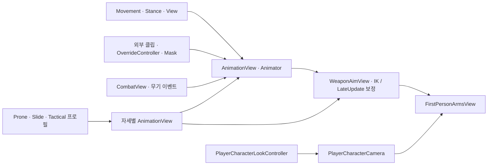
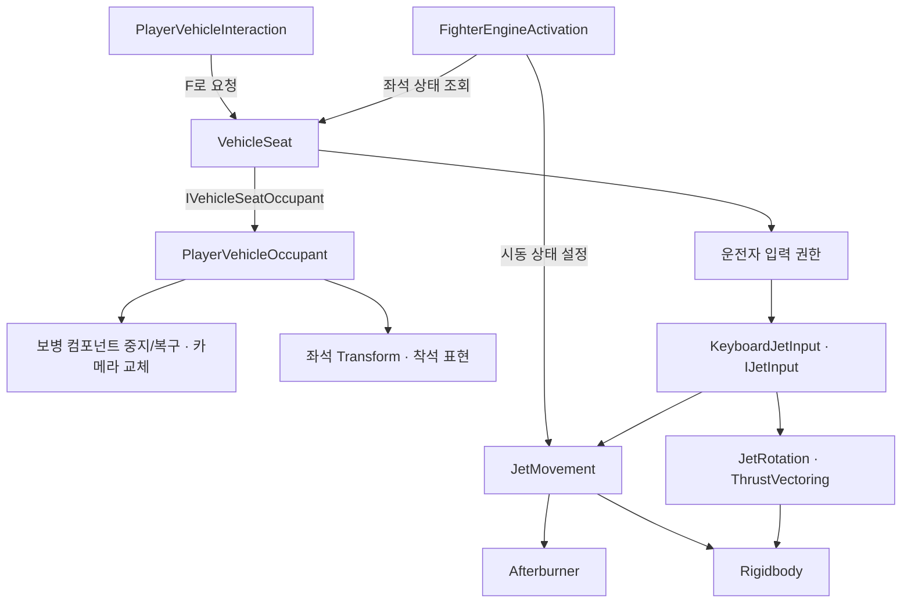
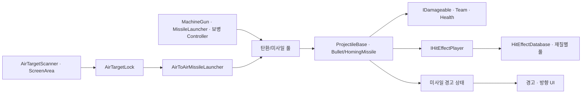

# 개발 구조

[목차](<README.md>) · [구조 점검](<Review.md>)

## 프로젝트 계층

Features.asmdef는 Framework와 Unity.InputSystem, Cinemachine, TMP, UI, WarFX.Runtime를 참조한다. Framework.asmdef는 Features를 참조하지 않는다. Editor 도구와 테스트는 별도 어셈블리다. 패키지 설치/어셈블리 참조가 실제 모든 기능의 사용을 뜻하지는 않는다. 카메라 구현의 중심은 자체 Camera/View 코드다.

## 보병 전투의 호출과 상태 조회

| 소유자 | 소유하는 상태 | 외부에서 하는 일 |
|---|---|---|
| Input | 액션 참조·입력 차단 | 입력 계약의 읽기 속성 조회 |
| Movement / Stance | 실제 이동·속도 / 자세·캡슐 | Tick·자세 전환 요청 |
| Controller | 다음 발사 시각·소총 단발 상태·전투 이벤트 | 상태 조회·무기 연결 |
| Loadout | 슬롯과 장비 목록 | TryEquip 요청·Changed 구독 |
| WeaponEquipment | 현재 무기 정의·장비별 탄창 | 모델/설정/탄창 조회 |
| Definition | 피해량·연사 속도·외형·애니메이션 설정 | 읽기 속성 조회 |
| WeaponMagazineState | 탄 수·예비탄·장전 종료 시각 | TryConsumeRound·TryReload 요청 |
| GrenadeThrow | 장착·조준·투척 모드·잔여 개수 | 장착/취소/투척 요청·궤적 조건 조회 |
| HUD / View | 표시 참조·보간/표현 상태 | 게임 상태와 이벤트로 화면 갱신 |

## 애니메이션과 시점

외부 애니메이션 원본, Animator/Mask 혼합, 사후 IK 보정을 각각 기록해야 문제 위치를 찾을 수 있다. WeaponAimView는 조준뿐 아니라 그립·장전·몸통 안정화·포복 접촉까지 담당한다. 개선 후보 A02를 참고한다.

## 탑승과 비행

VehicleSeat는 좌석 점유·입력 권한·하차 공간을 담당하고, Occupant는 캐릭터의 실제 부착/복구를 담당한다. 시동 연동은 FighterEngine에 분리되어 있다. JetCamera는 Orbit·Lens·DestructionView를 합성해 사용한다.

## 공통 전투·표적·표현

## 오디오 관리와 재생

AudioOverviewEditor가 Fighter 및 관련 프리팹의 AudioProfile/AudioSource 연결을 모아 보여준다. 재생은 FighterEngineAudio, MachineGunAudio, MissileLaunchAudio, MissileFlightAudio가 각각 엔진 상태·발사 이벤트·투사체 생명주기를 따라 처리한다. Profile은 설정을, AudioSource는 재생 위치와 출력 상태를 가진다.

## Editor에서 추가되는 연결

`PlayerCharacterSceneComposition`이 Play 진입과 빌드 씬 처리에서 슬라이드 → 포복 → 무장 이동 → 전술 동작 순서로 구성한다. 편집 중 Hierarchy에 없는 컴포넌트가 Play에서 생길 수 있다. `TacticalActionSceneSetup`은 PlayerCharacter에 Mantle·GrenadeThrow·GrenadeTrajectoryView를 추가하고 Animator에 TacticalAnimationView를 연결한다. 프로필이 없거나 유효하지 않은 구성은 생략된다.
